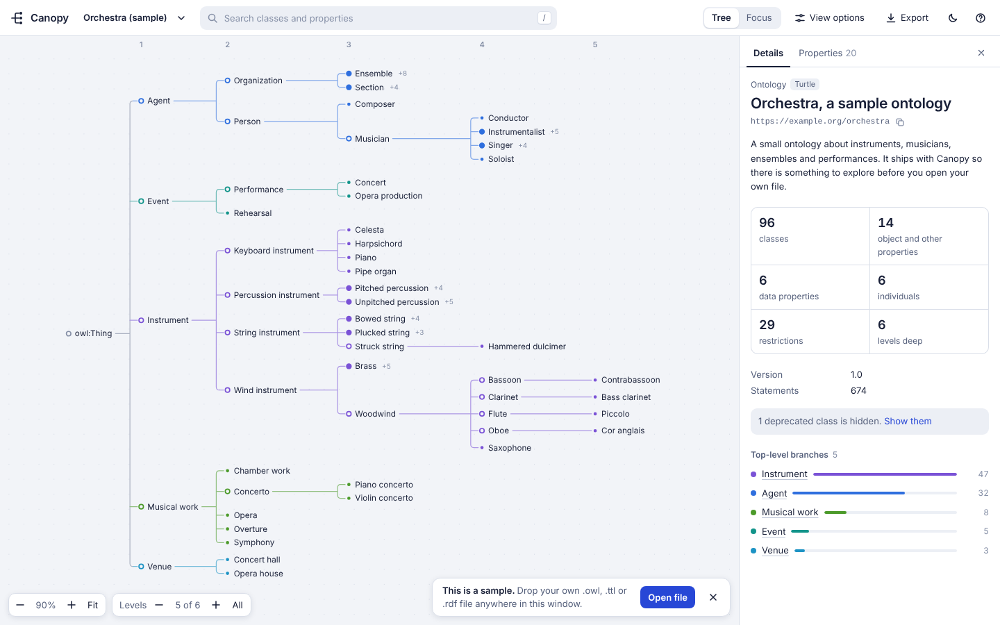
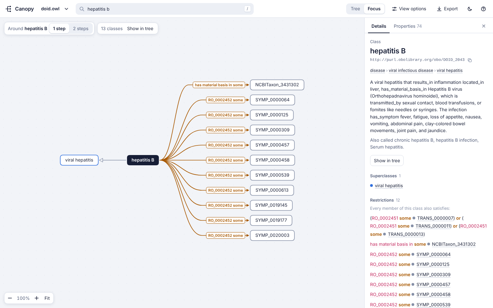
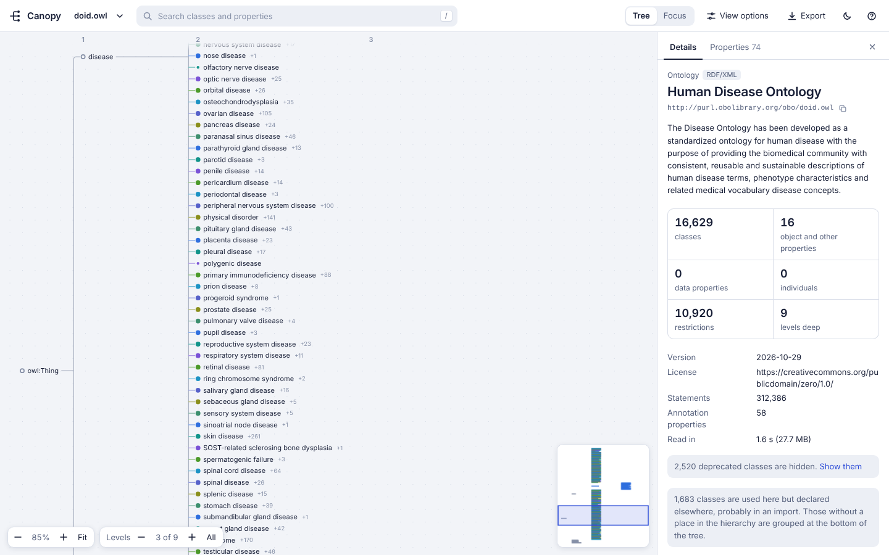

# Canopy

An ontology viewer in one HTML file. Download [`canopy.html`](canopy.html), double-click it, and drop an OWL, RDF or Turtle file onto the window. Nothing is installed and nothing leaves your computer.

Try it in the browser: <https://alexfischman.github.io/canopy/>



## Why

Most ontology viewers draw classes and every relation between them in one force-directed graph. That mixes two different structures: the hierarchy, which has a natural order, and the cross-cutting relations (properties, restrictions), which have none. Past a few hundred classes the result is a hairball.

Canopy separates the two:

- **The hierarchy gets a deterministic layout.** A collapsible left-to-right tree in which every class has a stable place and labels never overlap.
- **Relations are drawn on demand.** Property and restriction links appear for the class you select or point at, not all at once.
- **You control how much is visible.** Collapse to a level, search and jump, or switch to a focus view of one class and its neighbours.

## What it does

| | |
|---|---|
| **Formats** | RDF/XML (`.owl`, `.rdf`), Turtle (`.ttl`), N-Triples (`.nt`). Open by file picker, drag and drop, or paste. Dropping several files merges them, for example an ontology and its imports. |
| **Tree view** | Collapsible hierarchy, coloured by top-level branch. Ancestors stay pinned at the edge of the screen while you scroll through a long list of siblings. Classes with several parents appear once; the other parents are drawn when you select the class. |
| **Focus view** | One class with its parents on the left, children and property targets on the right, one or two steps out. Click a neighbour to refocus. |
| **Details panel** | Label, IRI, description, superclasses, subclasses, properties (direct and inherited), restrictions in Manchester-style text, equivalences, disjointness, individuals, annotations. |
| **Search** | Labels, identifiers and synonyms, for classes and properties. Matches inside collapsed branches are marked on the branch. |
| **Large files** | Parsing runs in a background worker; only what is on screen is drawn. Zoomed out, the largest branches keep readable labels. |
| **Export** | PNG of the current view, or the visible outline as text. |
| **Also** | Light and dark theme, label language switch, keyboard navigation, SKOS concept schemes when a file has no OWL classes. |



The Help button in the app lists the mouse and keyboard controls.

## What it does not do

- **No reasoning.** It shows what is asserted in the file, not what a reasoner would infer. Named classes in an equivalent-class intersection are treated as parents, as Protégé does in its asserted hierarchy.
- **No editing.** It is a viewer.
- **No JSON-LD, OWL/XML, functional or Manchester syntax.** These are detected and reported with a hint on how to convert them.
- **Imports are not fetched.** The page never uses the network. Drop the imported files together with the ontology instead.
- **Instances are only counted and listed** per class.

## Privacy and safety

`canopy.html` contains no external scripts, styles, fonts or images and makes no network requests. Files you open are parsed in the page. Text from a file is inserted as text, never as HTML. The only thing stored is your light/dark choice, in the browser's local storage.

## Build

The viewer is assembled from the files in `src/`. There are no dependencies.

```sh
python3 build.py        # writes canopy.html
```

| File | Content |
|---|---|
| `src/core.js` | Turtle/N-Triples parser, RDF/XML parser (with its own small XML reader), and the schema model. No DOM; runs in the page, in a worker and in Node. |
| `src/ui-a.js` | Tree layout, canvas rendering, relation arcs, minimap, focus view. |
| `src/ui-b.js` | Details panel, search, menus, dialogs, file handling, input. |
| `src/sample.ttl` | The built-in sample ontology. |
| `src/style.css`, `src/template.html` | Styles and page skeleton. |

## Tests

The tests need Node, Python 3 with `rdflib` and `playwright`, and the test data, which is downloaded rather than committed because it is third-party work:

```sh
pip install rdflib playwright && playwright install chromium
test/fetch-data.sh                      # ontologies and the W3C parser test suites, about 85 MB
python3 test/w3c.py                     # parser conformance
python3 test/compare.py +test/data/pizza/pizza.owl test/data/doid/doid.owl   # model against rdflib
python3 test/large.py                   # load time, label overlaps and frame time per ontology
python3 test/smoke.py                   # every control once, fails on any page error
python3 test/interact.py                # export, zoom, levels, paste, narrow screens, no network
```

Set `CHROME=/path/to/chrome` to use an installed browser instead of Playwright's Chromium.

Results at the time of the first release:

- **W3C suites.** All positive tests pass for Turtle (145 evaluation, 74 syntax) and N-Triples (41), and 124 of 126 for RDF/XML. The two exceptions concern canonical XML literals. Some negative tests are accepted on purpose: N-Triples is read with the Turtle parser, and duplicate `rdf:ID` values are tolerated.
- **Against rdflib.** Triples, declared classes, superclasses, property kinds, restrictions and deprecations agree on ten ontologies, from 20 to 16,629 classes.
- **In the browser.** Headless Chrome, offline, on a two-core machine:

| Ontology | Classes | File | Load | Label overlaps |
|---|---|---|---|---|
| Brick 1.4.4 | 1,797 | 1.7 MB | 0.2 s | 0 |
| schema.org 29.0 | 960 | 1.0 MB | 0.1 s | 0 |
| ENVO | 7,073 | 10 MB | 0.8 s | 0 |
| Human Disease Ontology | 16,629 | 29 MB | 1.7 s | 0 |

Only Chrome has been tested. The code uses standard APIs, but Firefox and Safari are unverified.



Opening the page with `#debug` appended to the address exposes a small `canopyDebug` object that the tests use.

## License

[MIT](LICENSE)
